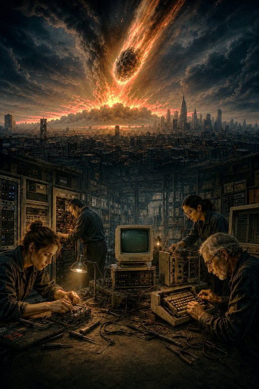

# The Great Reset

## CyberSci Nationals 2025/26

## Backstory

> In 2025, a giant meteor exploded upon entering Earth's atmosphere. In the aftermath of the resulting electromagnetic pulse (EMP), all active modern electronic devices were either destroyed, crippled, or rendered inert.
>
> We spent a year recovering. We scavenged, scoured, hacked, and scrapped together what we had lost: communications networks, data centers, personal computers, mobile devices, so many things we took for granted. Where we couldn't recover, we improvised, digging through archives and museums and junkyards. It was a beautiful display of human creativity and collaboration, true innovation at play.
>
> Now that humanity has mitigated total societal collapse, however, some have decided that this is a zero-sum game. Agents operate in the shadows, beyond mere bandits and script kiddies. Attacks against our new infrastructure have almost tripled in the last few months, and rumours abound that some have managed to resurrect powerful AIs. On top of that, we're still trying to work out old tech that, to us, is new all over again.
>
> Welcome to post-apocalypse Canada. We might already be at cyber war . . . again.

## Challenges

Challenges in this repo are for [CyberSci Nationals 2025/26](https://ctftime.org/event/3125) competition.

| Name | Category | Author |
| :--- | :---: | :---: |
| [Foreign message](challenges/jeopardy/forensics/foreign-message)   | Forensics | @0xd13a |
| [Dropped stack](challenges/jeopardy/forensics/dropped-stack)       | Forensics | @0xd13a |
| [DOOMsday](challenges/jeopardy/re/doomsday)                        | RE        | @0xd13a |
| [ShellNet](challenges/jeopardy/pwn/shellnet)                       | Pwn       | @ApprenticeofEnder |
| [Assault and Battery](challenges/jeopardy/web/assault_and_battery) | Web       | @ApprenticeofEnder |
| [Avian Carrier](challenges/jeopardy/re/avian_carriers)             | RE        | @Ch0ufleur |
| [Quote Vault](challenges/jeopardy/web/quote_vault)                 | Web       | Guillaume & Tristan |
| Warmups - Flags Galore                                             | Warmup    | @Fen-nix |
| Warmups - Obscura                                                  | Warmup    | @Fen-nix |
| Post-Apocalyptic Social Media                                      | Network   | @Fen-nix |
| Warmups - Potato Farm                                              | Warmup    | @Fen-nix |
| [Hey There Eliza](challenges/jeopardy/re/hey-there-eliza)          | Web       | @MajeedAB |
| [Secret Suitor](challenges/jeopardy/misc/secret-suitor)            | OSINT     | @MajeedAB |
| [Dead Air](challenges/jeopardy/pwn/dead-air)                       | Pwn       | @SenequeZ |
| [Telephoney](challenges/jeopardy/forensics/telephoney)             | Forensics | @crazyeights225 |
| [Factory Defaults](challenges/jeopardy/re/factory_defaults)        | RE        | @crazyeights225 |
| [underground-chat](challenges/jeopardy/web/underground-chat)       | Web       | @ehhthing |
| [underground-bank](challenges/jeopardy/web/underground-bank)       | Web       | @ehhthing |
| [Git Good Gemma](challenges/jeopardy/misc/gitgoodgemma)            | AI        | @jacksimple |
| [Printer](challenges/jeopardy/pwn/printer)                         | Pwn       | @jtyliu |
| [AOL (ApocalypseOnLine)](challenges/jeopardy/crypto/aol)           | Crypto    | @raedfayad |
| [CyberKinz](challenges/jeopardy/crypto/cyberkinz)                  | Crypto    | @raedfayad |
| [CySpace.com Part II](challenges/jeopardy/crypto/cyspace-2)        | Crypto    | @raedfayad |
| [Hardware badge](challenges/jeopardy/badge)                        | Hardware  | @t1v0 |
| [Rust In Peace](challenges/jeopardy/pwn/rust-in-peace)             | Pwn       | @willemgooderham |
| [Hidden Layers](challenges/jeopardy/stego/hidden-layers)           | Stego     | @willemgooderham |
| [Banking](challenges/defence/services/banking)                     | Defence   | @0xd13a |
| [Deployment Hell](challenges/defence/services/deployment_hell)     | Defence   | @ApprenticeofEnder |
| [Peak science](challenges/defence/services/peak_science)           | Defence   | @Linden-Brochu |
| [CySpace](challenges/defence/services/cyspace)                     | Defence   | @trentholmes |

