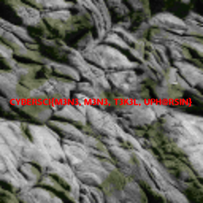

# DOOMsday

**Author:** 0xd13a

**Category:** RE

## Description

Challenge is based on a popular Game of DOOM, with 3 secrets embedded in the executable that require reverse engineering.

Game was modified to remove cheats and ability to save and restore games.

### Files

`doomsday.zip`

## Part 1

**CTFd name:** DOOMsday I 

### CTFd Description

> The cataclysm was incredibly traumatic to the human psyche. Flynn Taggart, a once brilliant engineer and software developer, snapped. He began actively resisting our efforts at restoring computing capacity, claming that the world is ending and that we should renounce all technology.

> Flynn rigged our main datacenter with explosives controlled by an old PC, running a modified version of DOOM. He then disappeared, leaving behing a rambling manifesto that referred to "three keys that control our destiny".

> We collected 3 passages from the manifesto that talk about them. Can you make sense of all of this and help us disable the bomb?

> First passage:

> ***...he, who destroys a 1000 monsters and utters a magic word, is worthy of seeing the first key...***

> **Note**: the flag format is `CYBERSCI()`, all upper case

### Flag

<details>
<summary>(expand to read)</summary><br>

`CYBERSCI(SL@Y TH3 MONST3R WI7HIN YOU)`

</details>

### Walkthrough

<details>
<summary>(expand to read)</summary><br>

First message refers to killing monsters. A close examination of the decompiled executable can bring up the following message: `Not so fast! You have %d more monsters to kill...`

This message is brought up by a new cheat code `idflag` (all other cheat codes are disabled and when they are entered, a taunting message is displayed).

Player can try and kill that many monsters but that would require a long time. 

By examining the algorithm we can see that with every monster killed, a global data area (which contains the flag) is modified. When a count of 1000 is reached it will be displayed in response to code `idflag`. 

See the first algorithm in [solve.py](solve_files/solve.py) to see how to decode the flag programmatically.

</details>

## Part 2

**CTFd name:** DOOMsday II 

### CTFd Description

> Second passage:

> ***...the next key is scrawled in blood of monsters on a secret wall...***

> **Note**: the flag format is `CYBERSCI{}`, all upper case


### Flag

<details>
<summary>(expand to read)</summary><br>

`CYBERSCI{M3N3, M3N3, T3K3L, UPH@RSIN}`

</details>

### Walkthrough

<details>
<summary>(expand to read)</summary><br>

To get the second flag we need to open the WAD file. An editor like [SLADE](https://slade.mancubus.net/) can be used for that purpose.

A simple examination of wall textures will lead us to image `WALL69_5` that contains the flag:



</details>


## Part 3

**CTFd name:** DOOMsday III

### CTFd Description

> Third passage:

> ***...only the one that preseveres to the end is rewarded with the final key...***


**Note**: the flag format is `CYBERSCI()`, all upper case


### Flag

<details>
<summary>(expand to read)</summary><br>

`CYBERSCI(WH4T DOE5NT KILL U M@KES U TIR3D)`

</details>

### Walkthrough

<details>
<summary>(expand to read)</summary><br>

Third passage alludes to playing the game to the end. If you play the first level, then in the intermission screen you will see an incomplete flag : 

```
CYBERSCI(W                               )
```

As you play the game, a new character is revealed with every new level completed, with the full flag displayed at the end of level 32.

To decode it, analyze the decompiled application source. It turns out that every character in the flag is decoded by XORing it with all characters in the name of the corresponding level.

See the second algorithm in [solve.py](solve_files/solve.py) to see how to decode the flag programmatically.

</details>


## Setup instructions

* To build the challenge run the following setup steps:

```
sudo apt install build-essential automake git
sudo apt build-dep crispy-doom
```

* Change to [doomsday_src/](doomsday_src/) and run the following commands:

```
autoreconf -fiv
./configure
make
```

* Package the challenge:

```
cd ../../release_files/
unzip ../server_files/doomsday_wad.zip 
cp ../server_files/doomsday_src/src/doomsday .
strip doomsday
zip doomsday.zip info.txt doomsday doomsday.wad
```
