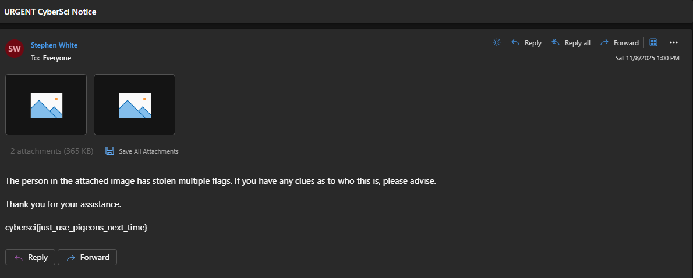

# enigmail

## First Impressions

Analyzing the encryption script, we can see that enigmail is different from the enigma challenge in many ways:

1. The original message/plaintext is an `email.eml` file.
2. The "crib" this time is a `logo.png` file that has been base64-encoded and with newlines every 76 characters.
3. We do not know the location of the crib, unlike the last challenge.
4. The message is being "base16" encoded (output contains only ABCDEFGHIJKLMNOP) prior to entering the Enigma cipher.

## Determining the crib and its location

First, we must get the known plaintext that is truly being encrypted by Enigma. The encryption code does some encoding.

```py
import base64

def base16encode(data: bytes) -> str:
    chars = 'ABCDEFGHIJKLMNOP'
    encoded = ''
    for byte in data:
        high_nibble = (byte >> 4) & 0x0F
        low_nibble = byte & 0x0F
        encoded += chars[high_nibble] + chars[low_nibble]
    return encoded

with open('files/output.txt') as f:
    CIPHERTEXT = f.read().strip()

with open('files/logo.png', 'rb') as f:
    CRIB = f.read()

CRIB = base64.b64encode(CRIB).decode()
CRIB = '\r\n'.join(CRIB[i:i+76] for i in range(0, len(CRIB), 76))
CRIB = base16encode(CRIB.encode())
```

To determine the crib's location within the ciphertext, we can use a flaw in Enigma where no ciphertext character will ever be equal to the plaintext character in the same position. Therefore, we can "slide" the crib along the ciphertext and check if the crib can possibly be at that position in the ciphertext.

```py
...

# find all positions where the crib can fit without letter conflicts
def check_crib_at_position(message, crib, position):
    for i in range(len(crib)):
        if message[position + i] == crib[i]:
            return False
    return True

for i in range(len(CIPHERTEXT) - len(CRIB) + 1):
    if check_crib_at_position(CIPHERTEXT, CRIB, i):
        print(f'Crib can fit at position: {i}')
        
        partial_ciphertext = CIPHERTEXT[i:i+500]
        partial_plaintext = CRIB[:500]
        print('Partial CT:', partial_ciphertext)
        print('Partial PT:', partial_plaintext)
```

The above scripts were combined into `1_determine_crib.py`, which output:

```
Crib can fit at position: 2514
Partial CT: PFDDHAILTMKJRQNTCKNKLOJEHOJZBJBGOTBAIWRSXXOKKUQRNYQMJUZCCKLMDCCZNZWGIWQFXGDUURPYOFBXJYEDDRKUSMFOTGIODPGRWNSGQYGSEXSAKTOEJZLGDPFJBIASVSJSRKCPACQKAUYJMZDJQQMMZGUMGXGRGNJIUECAIVKMHKNRSCNHIXRXXYGKZXDSOKJVIFDPIHBTRWBZKIKKFHV...
Partial PT: GJFGECEPFCHHDAELEHGHGPEBEBEBEBEOFDFFGIEFFFGHEBEBECHGFFEBEBEBEIFIEDEBFJEBEBEBEDENEGDJGBHGEBEBEBEBEBFIEOFDFCDAEJEBHCHDDEGDDGFBEBEBEBEBFCGOFBFFDBECEBEBEDHIANAKGKHHHGDIFJFBFFEBEBEBEBEKGDEFGIFKGDHHEBEBEMGJEJEBEBEDDEGJEBGBHCG...
```

Only one possible location.

## Using Multiple Bombe to determine initial machine settings

We can then enter this partial ciphertext into CyberChef's Multiple Bombe along with the partial plaintext as the crib. You may need to choose different lengths of the crib until the Multiple Bombe gives a good result. After a few attempts, this CyberChef Multiple Bombe recipe was used:

```
https://gchq.github.io/CyberChef/#recipe=Multiple_Bombe('German%20Service%20Enigma%20(First%20-%203%20rotor)','EKMFLGDQVZNTOWYHXUSPAIBRCJ%3CR%5CnAJDKSIRUXBLHWTMCQGZNPYFVOE%3CF%5CnBDFHJLCPRTXVZNYEIWGAKMUSQO%3CW%5CnESOVPZJAYQUIRHXLNFTGKDCMWB%3CK%5CnVZBRGITYUPSDNHLXAWMJQOFECK%3CA','','AY%20BR%20CU%20DH%20EQ%20FS%20GL%20IP%20JX%20KN%20MO%20TZ%20VW','GJFGECEPFCHHDAELEHGHG',0,true)&input=UEZEREhBSUxUTUtKUlFOVENLTktMT0pFSE9KWkJKQkdPVEJBSVdSU1hYT0tLVVFSTllRTUpVWkNDS0xNRENDWk5aV0dJV1FG
```

Which provides the result
```
Rotors: EKMFLGDQVZNTOWYHXUSPAIBRCJ, VZBRGITYUPSDNHLXAWMJQOFECK, AJDKSIRUXBLHWTMCQGZNPYFVOE
Reflector: AY BR CU DH EQ FS GL IP JX KN MO TZ VW

Rotor stops / Partial plugboard / Decryption preview
ROZ / FH AN BJ CK DD EO GW IR LL MQ PP TZ / GJFGECEPFCHHDAELEHGHGQHPLC
```

## Fine-tuning ring settings, initial positions, and the plugboard

### Right Rotor

From here we use our script from the previous enigma challenge to determine the right-most rotor ring. This script has been modified (`2_find_rotor_rings.py`) to output the number of correct characters as a "likeness" value.

Running `2_find_rotor_rings.py` provides the output:

```
...
Ring Settings: A A U, Initial Positions: ROT => Decrypted Text: GJFGECEPFCHHDAELEHGHGQHBEBEBEBEOFDFFGIEXFFGHEQEMLCHGFWEBEBEBEIFIEDEBFJEB, Likeness: 65
Ring Settings: A A V, Initial Positions: ROU => Decrypted Text: GJFGECEPFCHHDAELEHGHGQEBEBEBEBEOFDFFGIEXFFGHEQEMECHGFWEBEBEBEIFIEDEBFJEB, Likeness: 67
Ring Settings: A A W, Initial Positions: ROV => Decrypted Text: GJFGECEPFCHHDAELEHGHGPEBEBEBEBEOFDFFGIEXFFGHEQEBECHGFWEBEBEBEIFIEDEBFJEB, Likeness: 69
Ring Settings: A A X, Initial Positions: ROW => Decrypted Text: GJFGECEPFCHHDAELEHGHIPEBEBEBEBEOFDFFGIEXFFGHEQOBECHGFWEBEBEBEIFIEDEBFJEB, Likeness: 67
Ring Settings: A A Y, Initial Positions: ROX => Decrypted Text: GJFGECEPFCHHDAELEHGEIPEBEBEBEBEOFDFFGIEXFFGHEEOBECHGFWEBEBEBEIFIEDEBFJEP, Likeness: 65
...
```

Our right-most ring setting is W and initial position is V.

### Plugboard

We also take note that, according to the encryption script, there should be 10 plugboard pairs. The Bombe only output 9 pairs (with two different letters). 1 pair may still need to be entered. The Bombe plugboard output was "FH AN BJ CK DD EO GW IR LL MQ PP TZ", which leaves "S U V X Y" as remaining letters. Of which, there will be 1 pair and 3 unconnected.

To find the final pair, we can compare our best decrypted text with the known plaintext:
```
GJFGECEPFCHHDAELEHGHGPEBEBEBEBEOFDFFGIEFFFGHEBEBECHGFFEBEBEBEIFIEDEBFJEB
GJFGECEPFCHHDAELEHGHGPEBEBEBEBEOFDFFGIEXFFGHEQEBECHGFWEBEBEBEIFIEDEBFJEB
                                       ^     ^       ^
```

F, B, Q, and W are already in the partial plugboard. So we resort to trying all possible combinations of the last remaining pair.

We start up a CyberChef recipe that has:
1. The Enigma settings determined so far.
2. A Find/Replace statement that simply appends the known plaintext to the next line.
3. A Diff statement that compares the decrypted ciphertext and the known plaintext.

Luckily, we get it on the first try (SU):
```
https://gchq.github.io/CyberChef/#recipe=Enigma('3-rotor','LEYJVCNIXWPBQMDRTAKZGFUHOS','A','A','VZBRGITYUPSDNHLXAWMJQOFECK%3CA','A','R','ESOVPZJAYQUIRHXLNFTGKDCMWB%3CK','A','O','EKMFLGDQVZNTOWYHXUSPAIBRCJ%3CR','W','V','AY%20BR%20CU%20DH%20EQ%20FS%20GL%20IP%20JX%20KN%20MO%20TZ%20VW','FH%20AN%20BJ%20CK%20DD%20EO%20GW%20IR%20LL%20MQ%20PP%20TZ%20SU',false)Find_/_Replace(%7B'option':'Regex','string':'$'%7D,'%5C%5CnGJFGECEPFCHHDAELEHGHGPEBEBEBEBEOFDFFGIEFFFGHEBEBECHGFFEBEBEBEIFIEDEBFJEB',true,false,true,false)Diff('%5C%5Cn','Character',true,true,false,false)&input=UEZEREhBSUxUTUtKUlFOVENLTktMT0pFSE9KWkJKQkdPVEJBSVdSU1hYT0tLVVFSTllRTUpVWkNDS0xNRENDWk5aV0dJV1FG
```

### Middle Rotor

Now we move on to uncovering the middle rotor ring setting by modifying the script again (`3_find_rotor_rings.py`):

```
...
Ring Settings: A A W, Initial Positions: ROV => Decrypted Text: GJFGECEPFCHHDAELEHGHGPEBEBEBEBEOFDFFGIEFFFGHEBEBECHGFFEBEBEBEIFIEDEBFJEB, Likeness: 72
Ring Settings: A B W, Initial Positions: RPV => Decrypted Text: GJFGECEPFCHHDAELEHGHGPEBEBEBEBEOFDFFGIEFFFGHEBEBECHGFFEBEBEBEIFIEDEBFJEB, Likeness: 72
Ring Settings: A C W, Initial Positions: RQV => Decrypted Text: GJFGECEPFCHHDAELEHGHGPEBEBEBEBEOFDFFGIEFFFGHEBEBECHGFFEBEBEBEIFIEDEBFJEB, Likeness: 72
...
```

Multiple ring settings that fully decrypt our sample of 72 characters. We re-run the script with 500 characters of ciphertext and known plaintext (`4_find_rotor_rings.py`):

```
...
Ring Settings: A F W, Initial Positions: RTV => Likeness: 453
Ring Settings: A G W, Initial Positions: RUV => Likeness: 479
Ring Settings: A H W, Initial Positions: RVV => Likeness: 500
Ring Settings: A I W, Initial Positions: RWV => Likeness: 474
Ring Settings: A J W, Initial Positions: RXV => Likeness: 448
...
```

Our middle rotor ring setting is H and initial position is V, and this decryption is an exact match.

## Backtracking

We have a nearly correct machine state, but for the position in the middle of the ciphertext. In order to decrypt any of the ciphertext that occurs before our crib, we need to backtrack.

This can likely be done by simulator the opposite rotation of the rotors. However, the only settings that will change or are unknown are:
- The unknown right rotor ring setting (26 possibilities).
- The rotor initial positions (26 * 26 * 26 possibilities).

Doing the math, there are ~500,000 possible machine states from the beginning, which is within bruteforcing range. So...

## Bruteforcing the beginning

We write a script to:
1. Iterate over each possible machine state (substituting in the right rotor ring setting and all rotor initial positions).
2. Decrypt the first 100 characters and check if all decrypted characters are within the base-16 alphabet (ABCDEFGHIJKLMNOP). An invalid decryption with have other characters (QRSTUVWXYZ).
3. If all decrypted characters are within the base-16 alphabet, print the machine settings and the fully decrypted 100 characters.

Running this script (`5_bruteforce_beginning.py`):

```
Ring Settings: A H W, Initial Positions: NYD => Decrypted Text: b'MIME-Version: 1.0\r\nDate: Sat, 8 Nov 2025 13:00:04 '
Ring Settings: B H W, Initial Positions: OYD => Decrypted Text: b'MIME-Version: 1.0\r\nDate: Sat, 8 Nov 2025 13:00:04 '
Ring Settings: C H W, Initial Positions: PYD => Decrypted Text: b'MIME-Version: 1.0\r\nDate: Sat, 8 Nov 2025 13:00:04 '
Ring Settings: D H W, Initial Positions: QYD => Decrypted Text: b'MIME-Version: 1.0\r\nDate: Sat, 8 Nov 2025 13:00:04 '
Ring Settings: E H W, Initial Positions: RYD => Decrypted Text: b'MIME-Version: 1.0\r\nDate: Sat, 8 Nov 2025 13:00:04 '
...
```

This looks promising. However, there are multiple possible machine states (26 lines total).

Now we modify the script to:
1. If the first 100 characters decrypt properly, decrypt the whole ciphertext.
2. Check if the whole decrypted ciphertext is base-16.
3. If so, output the decrypted ciphertext to a `email.eml` file.

Running this script (`6_decrypt_all.py`) outputs an `email.eml` file.

## Solved

Opening the email file in a text editor shows us:

```
The person in the attached image has stolen multiple flags. If you have
any clues as to who this is, please advise.
cybersci{just_use_pigeons_next_time}
```

Or opening the file in an email client:




