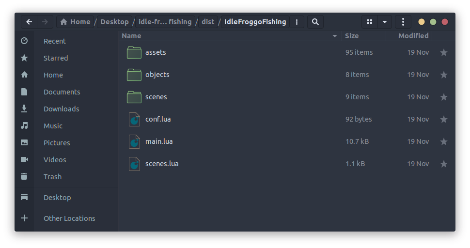
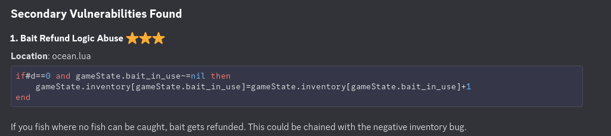

# _fishing-game_

**Author:** _ES_

**Category:** _Re_

## Description

A REV/pwn challenge that requires players to find a logic bug in a fishing game

### Files

`FishingGame.exe`

### Host

_Host to connect to (e.g. `nc` command), a URL, etc._

`10.0.2.61:5901` over vnc

## Part 1

**CTFd name:** fishing-game

### CTFd Description

You are a frog, you long for the sea, and to fish. Unfortunately, you lack funds, so you must grow your weath. Who knows, maybe you'll even be able to buy a flag.
Connect to the box over vnc on port `5901`. Password is `changeme`
You are also given a copy of the binary to test locally, note it does not contain the flag.

### Depends on

n/a

### Flag

<details>
<summary>(expand to read)</summary><br>

`CyberSci{D0nt_t4k3_th3_ba1t_72ab2e}`

</details>

### Walkthrough

<details>
<summary>(expand to read)</summary><br>

Unpack the exe file to uncover the lua source. 



Analyze the source. Or give it to an LLM, it can find this vulnerability 🤡



Find the bug involving the item duplication: when your strength is negative and you can’t catch any fish, it will give you back your bait when you fail to fish. If you unequip your bait it will give you 1 extra bait per fishing attempt, which can be sold to gain coins and buy the flag. 

To do this you buy a Swift rod, which gives you -3 strength, and any bait. Over time as you gain more coin, buy better bait to duplicate, which is worth more, and grows your wealth faster.

Here is a video showing me exploiting the vulnerability, it took about ~12 minutes. (click image below)

[](https://youtu.be/NuGNTvvjeew)

Note: there are multiple ways to complete this challenge (including just playing the game long enough), this is just the intended solve.

</details>


## Setup instructions

Copy fishy-vnc.zip to the vm and unzip it, then cd into the folder.s

Run:
```
docker build -t fishy-vnc .
docker run -p 5901:5901 --name fishy-vnc-live fishy-vnc
```
